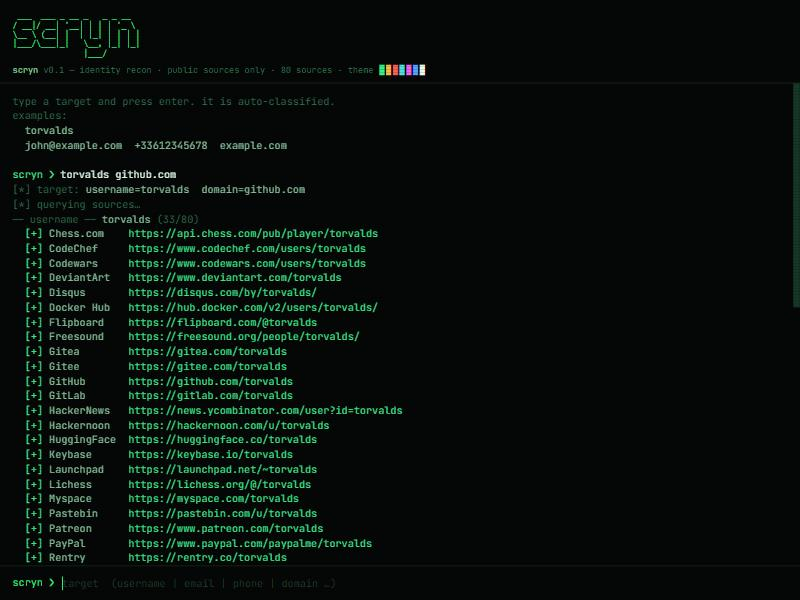
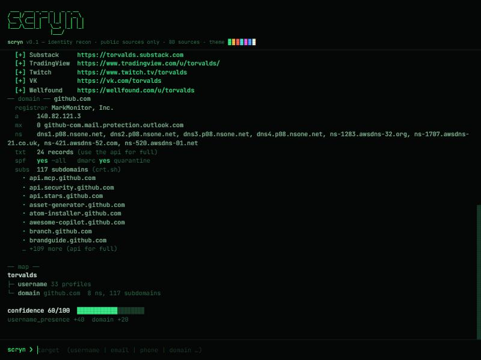

<div align="center">

<pre>
 ___  ___ _ __ _   _ _ __
/ __|/ __| '__| | | | '_ \
\__ \ (__| |  | |_| | | | |
|___/\___|_|   \__, |_| |_|
               |___/
</pre>

**OSINT recon from a single identifier: username, email, phone or domain.**




</div>

Give Scryn a handle and it checks ~80 sites for it, enriches emails and phone
numbers, runs domain recon (WHOIS, DNS, crt.sh subdomains, SPF/DMARC) and ties
it all together with a confidence score. Comes with a CLI, a REST API and the
terminal UI above.

Public sources only, no API keys. For authorized research. Don't use it to
harass, stalk or profile people without consent.

## Why not just Sherlock

Most username checkers happily report accounts that don't exist. Every site
here is calibrated before it makes the list: a known handle has to be found and
a random one has to not be, otherwise the site is dropped. There's a test that
proves it (`pytest -m network`).

## Install

```
git clone https://github.com/white-exee/Scryn.git
cd Scryn
python -m venv .venv
.venv\Scripts\activate            # linux/macos: source .venv/bin/activate
pip install -r requirements.txt
pip install -e .                  # optional, gives you the `scryn` command
```

## Usage

```
scryn --username torvalds --domain example.com
scryn username torvalds
scryn email jane@example.com
scryn phone +33612345678
scryn domain example.com
scryn -h
```

Flags (work on any command): `--json`, `--output file.{json,md,txt}`,
`--color {green,amber,red,cyan,magenta,blue,white,mono}`, `--no-color`.
No install? use `python cli.py ...` instead of `scryn`.

Domain recon pulls subdomains from certificate transparency and reads the
mail-security posture, on top of WHOIS and DNS:

<div align="center">

</div>

Web UI:

```
uvicorn app.main:app
```

then open `http://127.0.0.1:8000/dashboard` (API docs live at `/docs`).

## API

```
GET  /api/username/{username}
GET  /api/email?value=...
GET  /api/phone?value=...
GET  /api/domain/{domain}
POST /api/scan
```

## How the score works

A rough 0-100 reflecting how much public signal turned up, not a verdict on
anyone. The maths lives in `app/core/correlate.py`:

```
username found on a site   +6 each, capped at 40
valid email format         +5
email domain has MX        +10
gravatar exists            +10
valid phone number         +15
domain whois registrar     +10
domain resolves (A/NS)      +5
subdomains found            +5
```

Capped at 100.

## Layout

```
app/
  main.py            fastapi app + /api/scan
  api/               username / email / phone / domain lookups
  core/correlate.py  fusion + scoring
  sources/           the site list
  web.py             dashboard
cli.py               command line
tests/               pytest
```

## Tests

```
pip install pytest
pytest                 # offline unit tests
pytest -m network      # live run, checks there are no false positives
```

## License

MIT.
